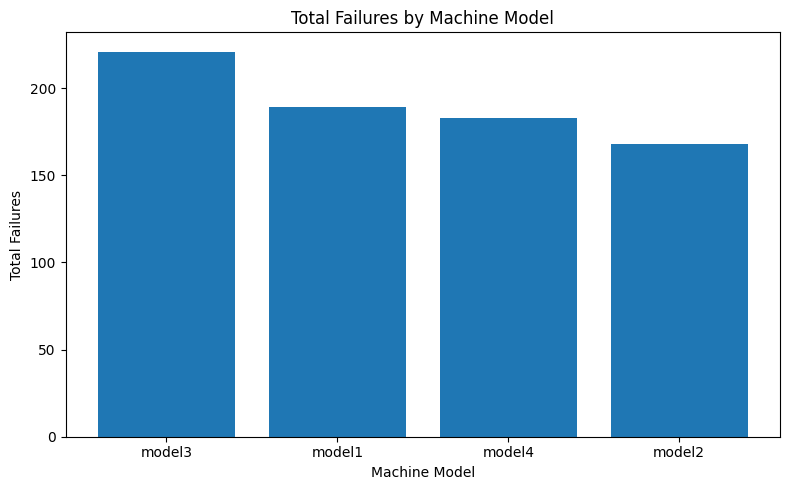
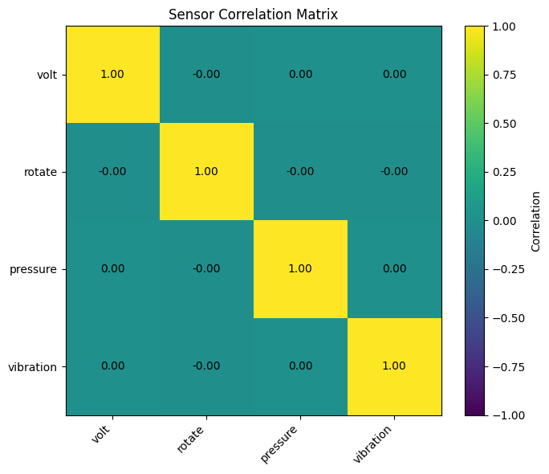
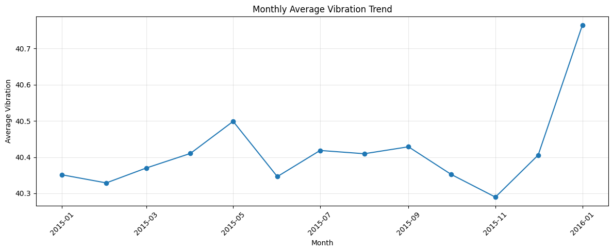
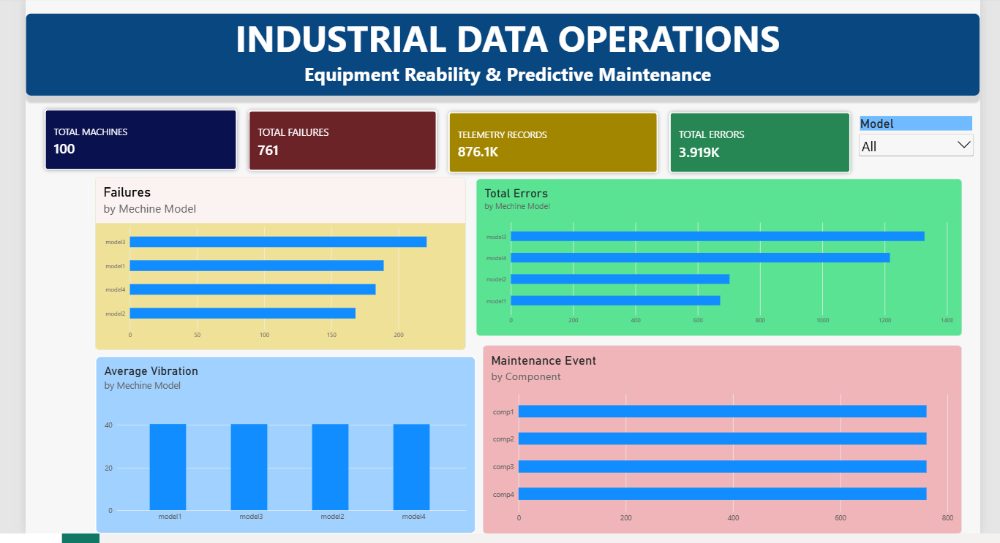
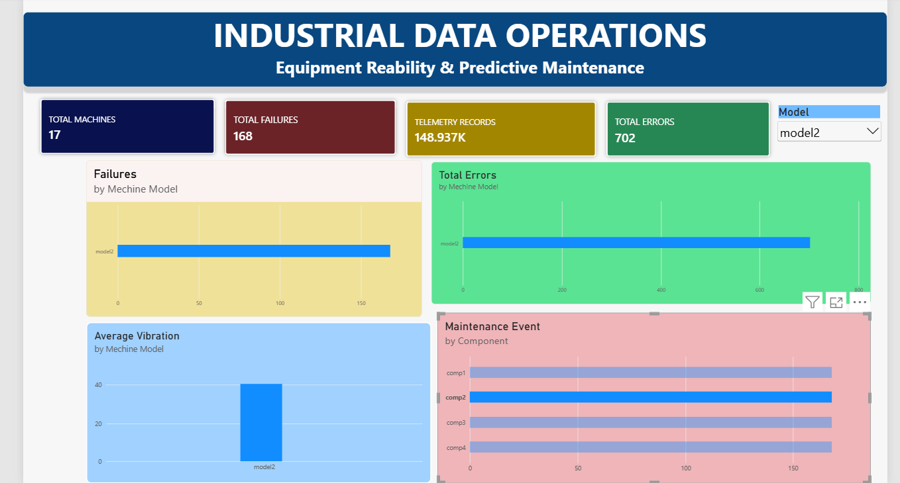

# Industrial Data Operations Pipeline

## Equipment Reliability & Predictive Maintenance Analytics

### 1. Project Overview

This project demonstrates an industrial data operations workflow using equipment telemetry, error logs, maintenance records, machine information, and failure events.

The objective is to build a structured and reproducible data pipeline that supports data quality monitoring, SQL-based operational analysis, and equipment reliability reporting.

The project uses a simulated predictive maintenance dataset to demonstrate how industrial data can be prepared and analyzed for operational decision-making.

## Project Highlights

| Metric                  |   |                                 Result |   |
| ----------------------- | - | -------------------------------------: | - |
| Machines Analyzed       |   |                                    100 |   |
| Telemetry Records       |   |                                876,100 |   |
| Error Records           |   |                                  3,919 |   |
| Failure Records         |   |                                    761 |   |
| Maintenance Records     |   |                                  3,286 |   |
| Machine Sensor Features |   | Voltage, Rotation, Pressure, Vibration |   |
| Data Processing         |   |                        Python & Pandas |   |
| Database                |   |                                  MySQL |   |
| Visualization           |   |                               Power BI |   |

## End-to-End Architecture

```text
Microsoft Azure Predictive Maintenance Dataset
                    |
                    v
          Python Data Profiling
                    |
                    v
          ETL & Data Cleaning
                    |
                    v
        Processed CSV Datasets
                    |
                    v
            MySQL Database
                    |
                    v
          SQL Operational Analysis
                    |
                    v
       Machine Reliability Summary
                    |
                    v
          Power BI Dashboard
```

## Project Layers Implemented

| Layer | Description |
|---|---|
| Layer 1 | Data ingestion and dataset profiling |
| Layer 2 | MySQL database setup and data import |
| Layer 3 | ETL, data cleaning, and transformation using Python |
| Layer 4 | Exploratory Data Analysis (EDA) and feature engineering |
| Layer 5 | SQL-based operational and reliability analysis |
| Layer 6 | Machine-level reliability feature dataset and validation |
| Layer 7 | Power BI data preparation and KPI development |
| Layer 8 | Power BI dashboard design and visualization |
| Layer 9 | EDA findings, dashboard reporting, and documentation |
| Layer 10 | GitHub portfolio documentation and project presentation |

## Key Features

- **Industrial Data Profiling:** Inspects data quality, missing values, duplicate records, and sensor measurements.
- **ETL Pipeline:** Cleans and transforms industrial equipment datasets using Python and Pandas.
- **Relational Database:** Stores and analyzes machine, telemetry, error, maintenance, and failure records in MySQL.
- **SQL Operational Analysis:** Summarizes equipment errors, failures, and maintenance records.
- **Feature Engineering:** Creates a machine-level dataset containing aggregated sensor measurements and operational indicators.
- **EDA and Data Visualization:** Explores sensor relationships, vibration trends, and failure patterns.
- **Power BI Dashboard:** Presents key metrics and comparisons across machine models and maintenance components.
- **Data Quality Validation:** Checks record counts, machine identifiers, duplicate IDs, and missing values in the final feature dataset.
- **Reproducible Workflow:** Organizes notebooks, SQL scripts, processed datasets, dashboard files, and reports into a structured project repository.

## Project Limitations

- The dataset contains simulated industrial equipment observations.
- Sensor outliers were identified during profiling and were not automatically removed.
- Error records, failure records, and maintenance records represent different operational events.
- The current dashboard focuses on descriptive and diagnostic analysis.
- A validated predictive failure model has not yet been implemented in this project.


### 2. Project Objectives

- Assess data quality, completeness, consistency, and integrity.
- Clean and validate industrial datasets through an ETL workflow.
- Integrate multiple datasets using MySQL.
- Analyze equipment errors, failures, maintenance activities, and sensor measurements.
- Develop a Power BI dashboard for equipment reliability monitoring.
- Prepare engineered features for further reliability analysis.

### 3. Dataset

**Source:** Microsoft Azure Predictive Maintenance Dataset

Kaggle: https://www.kaggle.com/datasets/arnabbiswas1/microsoft-azure-predictive-maintenance

The project uses five datasets:

| Dataset | Description |
|---|---|
| `PdM_machines` | Machine identifiers, models, and age |
| `PdM_telemetry` | Time-series sensor measurements |
| `PdM_errors` | Recorded machine error events |
| `PdM_maint` | Maintenance records by machine and component |
| `PdM_failures` | Recorded failure events |

### 4. Technology Stack

- Python and Pandas — data profiling, cleaning, and transformation
- Google Colab — notebook-based data processing
- MySQL — relational data storage, joins, and operational analysis
- Power BI — dashboard development and visualization
- Git and GitHub — version control and project documentation

### 5. Project Workflow

1. **Data Profiling:** inspect schemas, missing values, duplicate records, data types, timestamps, and sensor outliers.
2. **ETL and Data Cleaning:** transform data types, validate identifiers, apply documented quality rules, and save processed datasets.
3. **SQL Integration and Analysis:** import datasets into MySQL, join related tables, and analyze error, failure, maintenance, and sensor patterns.
4. **EDA and Feature Engineering:** explore sensor distributions and temporal patterns, then create machine-level and time-based features.
5. **Power BI Dashboard:** visualize operational KPIs, failures by machine model, maintenance activity, and sensor indicators.
6. **Documentation:** record methodology, data quality checks, analytical findings, and limitations.


### 6. SQL and EDA Findings

The SQL analysis and exploratory data analysis identified several operational patterns:

**SQL Findings**
- Machine 22 recorded 60 errors, the highest count among the machines reviewed in the initial SQL analysis.
- Machine 99 recorded the highest machine-level failure count in the initial comparison, with 19 events.
- Component `comp2` had 259 recorded failure events and 863 maintenance records.
- Average vibration measurements were similar across machine models in the initial summary.

**EDA Findings**
- Machine 99 had the highest failure count among the top 10 machines displayed, with approximately 19 events.
- Model 3 recorded the highest total failure count among the machine models, with 221 events.
- Average vibration was similar between machines with and without recorded failures when aggregated across the observation period.
- Monthly average vibration was relatively stable, with an increase in the final plotted month.
- Pairwise sensor correlations were close to zero in the displayed Pearson correlation matrix.

## EDA Findings

### 1. Vibration vs Pressure


This chart explores the relationship between equipment vibration and pressure measurements.

### 2. Total Failures by Machine Model




This chart compares recorded failures across different machine models.

### 3. Sensor Correlation Matrix



The correlation matrix helps identify relationships between sensor variables.

### 4. Monthly Vibration Trend



This chart shows how average equipment vibration changes over time.

**Operational Implications**

Machines with high recorded failure counts should be investigated using historical failure records, component-level patterns, maintenance history, and sensor trends.

These findings are descriptive and do not establish causality or predict future failures. Comparisons between machine models should account for the number of machines in each model.

### 7. Power BI Dashboard

## Dashboard Screenshots




See the `reports/` folder for dashboard screenshots.

The Power BI dashboard provides an overview of equipment reliability and maintenance activity.

**Key Performance Indicators**
- Total Machines
- Total Failures
- Telemetry Records
- Total Errors

**Visualizations**
- Failures by Machine Model
- Total Errors by Machine Model
- Average Vibration by Machine Model
- Maintenance Events by Component

**Interactive Feature**
- Machine model slicer for filtering relevant dashboard visuals.

The dashboard is designed to support operational monitoring and exploratory analysis. KPI calculations, chart aggregations, and filter interactions should be validated against the source datasets before final publication.


### 8. Data Quality and Limitations

- Sensor outliers are not automatically removed because unusual readings may represent meaningful operating conditions.
- Error events and failure events are treated as different types of operational records.
- High maintenance counts do not necessarily indicate poor reliability.
- Sensor averages alone are insufficient to establish equipment failure risk.
- This project currently focuses on data operations and descriptive reliability analysis; it does not yet claim a validated predictive model.

### Feature Engineering Validation

The machine-level feature dataset passed the implemented validation checks.

- Total records: 100
- Unique machines: 100
- Duplicate machine IDs: 0
- Missing values in the final feature dataset: 0

The resulting dataset combines machine attributes, aggregated sensor measurements, and counts of recorded errors, failures, and maintenance events.

The dataset was saved as `machine_reliability_features.csv` in the processed data directory.

These checks confirm structural completeness for the tested conditions, but do not independently guarantee the semantic correctness of every feature or establish predictive performance.


### 9. Project Status

- [x] Initial data profiling
- [x] ETL processing and processed data storage
- [x] MySQL data import and initial SQL analysis
- [x] EDA and feature engineering
- [x] Feature dataset validation
- [x] Initial Power BI dashboard
- [x]Final dashboard metric and interaction validation
- [x]Final documentation and GitHub publication

### 10. Expected Outcome

The project aims to demonstrate practical skills in industrial data handling, data quality assurance, ETL workflows, relational data integration, SQL analysis, and operational reporting.

The final deliverable will be a documented and reproducible portfolio project that illustrates how industrial datasets can be transformed into structured information for reliability and maintenance analysis.